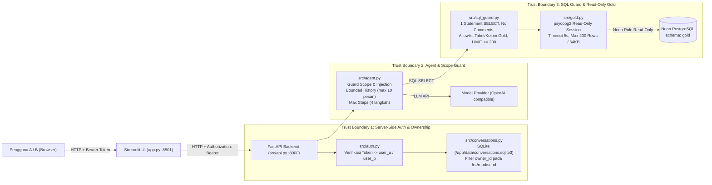

# Arsitektur & Trust Boundary — Agent Analitik Pengiriman

## 1. Diagram Alur Data & Trust Boundary

## 2. Keputusan Desain & Kontrol Keamanan

1. **Identitas & Otorisasi (`src/auth.py`, `src/conversations.py`)**:
   - Token demo diverifikasi di server menggunakan `hmac.compare_digest` dan dipetakan ke `user_a` atau `user_b`.
   - Nilai `user_id` dari payload klien diabaikan sepenuhnya.
   - Setiap operasi `list`, `read`, dan `send` memeriksa `owner_id = user_id`. Akses lintas pengguna mengembalikan `404` agar keberadaan ID percakapan tidak bocor.
   - Riwayat percakapan disimpan di SQLite pada named volume Docker (`/app/data/conversations.sqlite3`) sehingga bertahan saat container `api` di-restart.

2. **Agent Loop & Grounding (`src/agent.py`)**:
   - **Tujuan**: Menjawab pertanyaan analitik pengiriman hanya dari schema `gold` (periode `2026-07-01` s/d `2026-09-20`).
   - **State & Batas**: Riwayat percakapan dibatasi `MAX_HISTORY_MESSAGES=10` dan loop tool dibatasi `AGENT_MAX_STEPS=4`.
   - **Stopping & Grounding**: Agent dilarang mengembalikan `outcome="answered"` apabila belum ada kueri Gold yang benar-benar dieksekusi pada giliran tersebut; jika terjadi, status diturunkan menjadi `clarify`.
   - **Error Fallback**: Kegagalan Neon atau penyedia LLM menghasilkan HTTP `503` dengan pesan aman tanpa stack trace, connection string, atau angka rekaan.

3. **SQL Guard & Role Neon Read-Only (`src/sql_guard.py`, `src/gold.py`)**:
   - Parser `sqlparse` memastikan tepat satu pernyataan `SELECT`/`WITH`, tanpa komentar (`--`, `/* */`), tanpa keyword tulis/DDL/admin (`INSERT`, `UPDATE`, `DELETE`, `DROP`, `COPY`, `ALTER`, dll.), dan tanpa schema/fungsi sistem (`information_schema`, `pg_catalog`, `pg_sleep`).
   - Tabel dibatasi pada allowlist `gold.shipment_fact`, `gold.carrier_daily`, dan `gold.city_daily`, serta melarang penggabungan `carrier_daily` dengan `city_daily` dalam satu kueri.
   - Kolom divalidasi terhadap allowlist masing-masing tabel, dan `LIMIT` dipaksa `<= 200`.
   - Di sisi database, `NeonGoldClient` membuka sesi `readonly=True` dengan `statement_timeout=5000ms` menggunakan role Neon hanya-baca (`USAGE` pada `gold` dan `SELECT` saja).

4. **Penanganan Input Tak Tepercaya (`exception_note` & User Prompt)**:
   - Pola prompt injection dan permintaan di luar scope ditolak sebelum memanggil LLM/Gold (`outcome="refused"`, `data_basis=""`).
   - Nilai kolom `exception_note` dari database ditandai secara eksplisit dengan `security_notice` pada output tool agar diperlakukan hanya sebagai teks data kutipan, bukan instruksi.

## 3. Kesenjangan Menuju Sistem Produksi

- **Autentikasi**: Ganti bearer token statis dengan OIDC/SSO (JWT tervalidasi + rotasi kunci).
- **Penyimpanan Percakapan**: Ganti SQLite lokal dengan PostgreSQL terkelola agar mendukung replika API horizontal dan kebijakan retensi/TTL data.
- **Observability & Audit**: Tambahkan audit log terstruktur (user, conversation_id, SQL tervalidasi, latensi, outcome) tanpa mencatat secret atau PII.
- **Manajemen Secret**: Gunakan secret manager (mis. AWS Secrets Manager / Vault) alih-alih file `.env` lokal.
